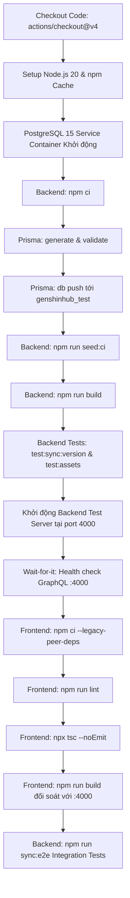

# GenshinHub — CI/CD Pipeline Architecture & Runbook

Tài liệu hướng dẫn kiến trúc và cách vận hành quy trình CI/CD của GenshinHub trên GitHub Actions.

---

## 1. Mục tiêu và Nguyên tắc Thiết kế

1. **Cô lập 100% khỏi Production**:
   - Bước `Build Frontend` (`next build`) thực hiện Static Site Generation (SSG) / Prerendering cho các dynamic routes (`/characters/[id]`, `/weapons/[id]`, `/artifacts/[id]`, `sitemap.xml`).
   - CI **không bao giờ** gọi tới GraphQL endpoint hay database production (Render / Neon).
   - Mọi kiểm thử và build trong CI sử dụng PostgreSQL service container nội bộ (`postgres:15-alpine`) và GraphQL server cục bộ (`http://localhost:4000/graphql`).

2. **Khắc phục lỗi lệch Schema (`Weapon.role`)**:
   - GenshinHub không duy trì migrations tĩnh (`prisma/migrations`) mà đồng bộ schema qua `npx prisma db push`.
   - CI tự động khởi tạo database test sạch (`genshinhub_test`) và chạy `npx prisma db push --force-reset --accept-data-loss` để đảm bảo 100% bảng và cột trong `schema.prisma` (bao gồm `Weapon.role`) đều tồn tại trên database.

3. **Fixtures Kiểm thử Độc lập (`seed-ci.ts`)**:
   - File `backend/prisma/seed-ci.ts` cung cấp bộ dữ liệu mẫu tối thiểu (Albedo, Cinnabar Spindle, Staff of Homa, Husk of Opulent Dreams, Tier Ranks, v.v.).
   - Hoạt động **100% offline**, không phụ thuộc API bên ngoài (`yatta.moe` / `ambr.top`), hoàn thành trong < 1 giây.
   - Cung cấp đầy đủ dữ liệu cho Next.js `generateStaticParams()` và metadata prerendering.

4. **Bảo toàn Dữ liệu Môi trường Triển khai (Production/Staging)**:
   - Trong môi trường deploy thực tế (Vercel, VPS, Render), ứng dụng tiếp tục trỏ tới GraphQL endpoint thật qua `NEXT_PUBLIC_GRAPHQL_URL`.
   - Không có bất kỳ mock data nào bị hardcode vào logic ứng dụng hay GraphQL resolvers.

---

## 2. Thứ tự Thực thi trong CI (`.github/workflows/ci.yml`)



### Chi tiết các bước:
| STT | Bước | Thư mục | Lệnh | Mục đích |
|---|---|---|---|---|
| 1 | Checkout & Setup | Gốc | `actions/checkout`, `actions/setup-node` | Cài đặt môi trường Node 20, cache dependencies |
| 2 | Install Backend | `./backend` | `npm ci` | Cài đặt dependencies backend |
| 3 | Prisma Generate | `./backend` | `npx prisma generate` | Sinh Prisma Client TypeScript |
| 4 | Prisma Validate | `./backend` | `npx prisma validate` | Kiểm tra cú pháp schema.prisma |
| 5 | Prisma DB Push | `./backend` | `npx prisma db push --force-reset` | Đồng bộ schema vào test PostgreSQL container |
| 6 | Seed CI Fixtures | `./backend` | `npm run seed:ci` | Nạp dữ liệu mẫu offline cho characters, weapons, artifacts |
| 7 | Build Backend | `./backend` | `npm run build` | Compile TypeScript backend sang `dist/` |
| 8 | Version Check Test | `./backend` | `npm run test:sync:version` | Kiểm tra version compatibility logic |
| 9 | Asset Test | `./backend` | `npm run test:assets` | Chạy 41 tests kiểm tra an toàn lưu trữ asset & mock CDN |
| 10 | Start Test Server | `./backend` | `node dist/src/index.js &` | Khởi động GraphQL server nội bộ trên port 4000 |
| 11 | Health check | Gốc | `curl -f http://localhost:4000/graphql` | Chờ GraphQL server phản hồi |
| 12 | Install Frontend | `./frontend` | `npm ci --legacy-peer-deps` | Cài đặt dependencies frontend |
| 13 | Lint Frontend | `./frontend` | `npm run lint` | Kiểm tra ESLint |
| 14 | Typecheck Frontend | `./frontend` | `npx tsc --noEmit` | Kiểm tra TypeScript type safety |
| 15 | Build Frontend | `./frontend` | `NEXT_PUBLIC_GRAPHQL_URL=... npm run build` | Prerender SSG toàn bộ 455 trang tĩnh |
| 16 | E2E Data Sync | `./backend` | `npm run sync:e2e` | 28 tests kiểm tra toàn vẹn sync pipeline & GraphQL |

---

## 3. Cách chạy Kiểm thử CI Cục bộ (Local Verification)

Trước khi commit hoặc push lên GitHub, lập trình viên có thể kiểm thử toàn bộ chuỗi CI trên máy local như sau:

```bash
# 1. Kiểm tra Backend
cd backend
npx prisma validate
npm run build
npm run test:sync:version

# 2. Chạy test assets (mock CDN, không cần DB)
npm run test:assets

# 3. Khởi động backend test server (nếu đã có DB cục bộ)
# PORT=4000 node dist/src/index.js &

# 4. Kiểm tra Frontend
cd ../frontend
npm run lint
npx tsc --noEmit

# 5. Build Frontend thử nghiệm
NEXT_PUBLIC_GRAPHQL_URL="http://localhost:4000/graphql" npm run build
```
